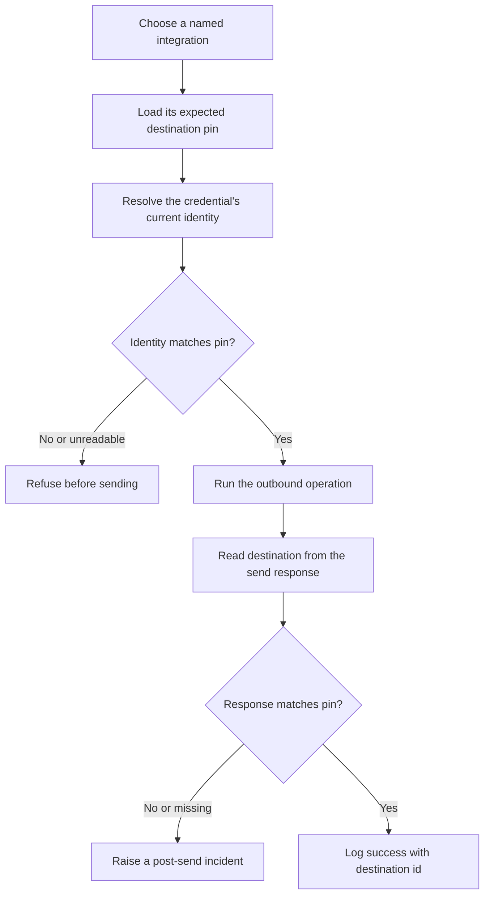

# Publish Destination Guard

A small Python library and CLI that makes outbound integrations prove where they will publish before they send.

## Why I built it

I built this after a pipeline posted a brand's videos to the wrong channel for three nights while every run logged `OK`. The upload API accepted no channel parameter, so the credential alone decided the destination. A successful request proved that the upload worked, but it did not prove that the upload landed in the intended account.

## How it works



- Each integration has a stable name and expected destination ID in a JSON registry.
- A resolver asks the active credential where it points. Built-in plugins support mock data, a value in a local JSON file, and an HTTP identity endpoint.
- A decorator or context manager checks the credential before the call and checks the returned destination after the call.
- The audit command resolves every pin without sending. `examples/github-actions/destination-audit.yml` is a ready GitHub Actions workflow that runs that audit on a schedule (copy it to `.github/workflows/` to turn it on).

## Guardrails

- Fail closed on a missing pin, empty expected ID, unknown resolver, failed identity lookup, or malformed registry.
- Stop before the outbound function runs when the credential identity does not match the pin.
- Treat a successful API response with no destination identity as a failure.
- Compare the send response with the original pin to surface destination drift that happened during the request.
- Put the pin name, destination name, and destination ID in every successful preflight, send, and audit line.
- Keep audits read-only. Resolver plugins identify accounts but never publish, email, charge, or trigger webhooks.
- Load credentials from environment variables. Registry examples contain placeholders and fictional IDs only.

The post-send check cannot undo an action that a provider already accepted. Its job is to make a wrong destination immediately visible, return a failing status, and prevent a misleading `OK` log.

## Quick start

The offline demo uses fictional data and needs no API keys:

```bash
python3 -m venv .venv
source .venv/bin/activate
python -m pip install -e .
destination-guard demo
```

Run the tests:

```bash
python -m pip install -r requirements.txt
pytest
```

For a real integration, copy the example registry, replace every placeholder with your own destination data, and provide secrets through environment variables:

```bash
cp examples/destination-pins.example.json destination-pins.json
cp .env.example .env
export PAYMENTS_API_TOKEN="your_test_token"
destination-guard --registry destination-pins.json check video_primary
destination-guard --registry destination-pins.json audit
```

Do not commit a populated `.env` or a private registry. The included `.gitignore` excludes `.env`.

### Guard a send with a decorator

```python
from destination_guard import DestinationGuard

guard = DestinationGuard.from_file("destination-pins.json")

@guard.guarded("video_primary")
def upload_video(file_path: str) -> dict:
    response = video_client.upload(file_path)
    return {
        "upload_id": response.id,
        "destination": {
            "channel_id": response.channel_id,
            "channel_name": response.channel_name,
        },
    }
```

### Guard a send with a context manager

```python
with guard.context("email_transactional") as permit:
    response = email_client.send(message)
    permit.confirm({"delivery": {"mailbox_id": response.mailbox_id}})
```

Leaving the block without `permit.confirm(...)` raises an error. This prevents application code from silently skipping the response check.

### Resolver plugins

The registry selects a resolver per pin:

```json
{
  "pins": {
    "payments_primary": {
      "expected_id": "account_example_789",
      "expected_name": "Example Brand Payments",
      "resolver": {
        "type": "http_identity",
        "url": "https://identity.example.com/v1/whoami",
        "headers": {
          "Authorization": "Bearer ${PAYMENTS_API_TOKEN}"
        },
        "id_path": "account.id",
        "name_path": "account.name"
      },
      "response_id_path": "payment_link.account_id"
    }
  }
}
```

Built-in resolver types:

- `mock`: uses an in-registry fictional identity for demos and tests.
- `file_value`: reads an ID and optional name from a local JSON file.
- `http_identity`: calls a JSON identity endpoint and can fill headers from environment variables.

Custom resolver objects can be registered without changing the guard:

```python
from destination_guard import Identity, ResolverRegistry

class WebhookResolver:
    def resolve(self, pin, base_dir):
        identity = webhook_client.who_am_i()
        return Identity(identity.endpoint_id, identity.label)

resolvers = ResolverRegistry()
resolvers.register("webhook_identity", WebhookResolver())
guard = DestinationGuard.from_file("destination-pins.json", resolvers=resolvers)
```

## Example output

```text
PREFLIGHT OK pin=northwind_video destination="Northwind Dental Video" id=channel_demo_2048
SEND OK pin=northwind_video destination="Northwind Dental Video" id=channel_demo_2048
DEMO COMPLETE sent=1 verified=1
```

An audit prints one destination-aware line per pin and exits nonzero if any pin is mismatched or unreadable:

```text
AUDIT OK pin=northwind_video destination="Northwind Dental Video" id=channel_demo_2048
AUDIT OK pin=northwind_notifications destination="Northwind Dental Notifications" id=mailbox_demo_0731
```

## Tech

- Python 3.10 or newer
- Standard library runtime using `json`, `urllib`, `dataclasses`, and `contextlib`
- pytest for offline tests
- GitHub Actions for the scheduled destination audit

## License

MIT. Copyright (c) 2026 Christian Terrone.
